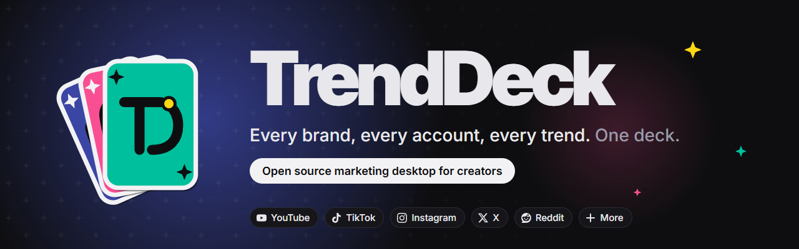

# TrendDeck-Web

The landing site for [TrendDeck](https://github.com/JoshWright22/TrendDeck), the open source marketing desktop for creators.

It's one scroll story called "dealt a hand". The page opens on the felt table with the logo's hand of cards, then a dealer deals six cards as you scroll. Each one flips over to show a feature you can poke at: brands, every account at once, trends, chat, posting, and the smaller stuff. It ends on "Play your hand" with the install steps.

Colors, type, cards, sparks and motion all follow the app's [brand guide](https://github.com/JoshWright22/TrendDeck/blob/main/docs/BRAND.md).

## Run it

You need [Node.js](https://nodejs.org) 22 or newer.

```bash
npm install
npm run dev        # dev server with hot reload
npm run build      # type check and build into dist/
npm run preview    # serve the build
```

Dev and preview both serve at `/TrendDeck-Web/`, same as the live site.

## How it's put together

Vite, TypeScript and Three.js. No framework.

```
index.html          all the copy and every card, as plain html
src/style.css       the whole look, plus the css card deal used in lite mode
src/main.ts         picks the mode, deals cards as they scroll into view, step dots
src/mode.ts         full or lite
src/features.ts     the small interaction on each card
src/scene.ts        the 3d table: the logo hand and the flying cards
public/assets       logo and banner, copied from the app repo
```

All the text is real html, so it reads fine with no WebGL and no script.

## Full and lite mode

Full mode draws the hero hand and the dealt cards in WebGL. Three.js is its own chunk and only loads after the first paint, so the first load is the html, one css file, a small script and the fonts.

Lite mode has the same content with css 3D cards and no WebGL. You get it when:

- you ask for reduced motion (cards also stop animating)
- WebGL is missing or only runs in software
- the GPU is on the weak list, the device reports under 4 GB of memory or 2 cores or fewer, or data saver is on
- full mode starts and the frame rate is bad, then it drops to lite on its own

There's a switch in the footer, and `?lite` or `?full` on the url forces one.

The canvas pixel ratio is capped at 2 and it only draws while something is moving.

## Deploying

Pushing to `main` runs `.github/workflows/pages.yml`, which builds and deploys to GitHub Pages. Pages has to be set to "GitHub Actions" as the source in the repo settings. The base path `/TrendDeck-Web/` is set in `vite.config.ts`, change it there if the repo is renamed.

## License

MIT, see [LICENSE](LICENSE). Fonts are Inter and Inter Tight, bundled from `@fontsource` under the SIL Open Font License.
